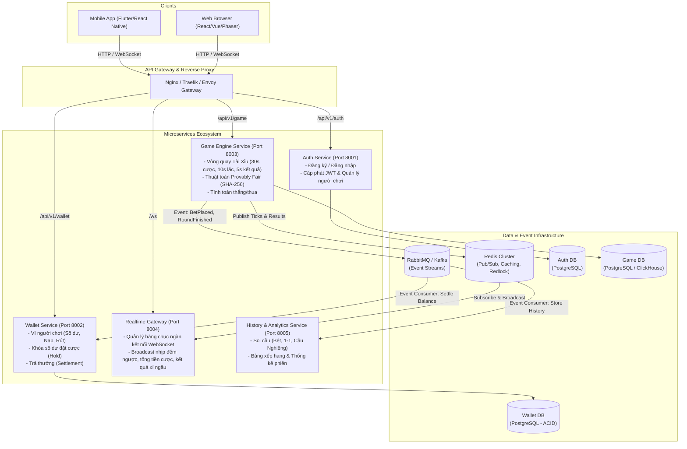
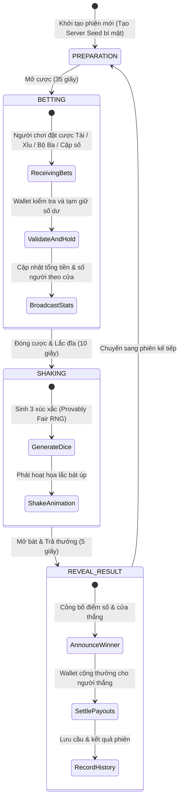

# Kiến Trúc Microservices Ứng Dụng Game Tài Xỉu

Hệ thống được thiết kế theo mô hình **Microservices hướng sự kiện (Event-Driven Microservices Architecture)**, đảm bảo khả năng mở rộng (high scalability), độ trễ thấp (low latency cho game thời gian thực) và tính toàn vẹn dữ liệu tài chính (ACID ledger).

---

## 1. Sơ Đồ Kiến Trúc Tổng Thể

---

## 2. Vòng Đời Của Một Phiên Game Tài Xỉu (Game Cycle State Machine)

Mỗi phiên Tài Xỉu vận hành tự động theo chu kỳ tuần hoàn khép kín:

---

## 3. Quy Ước Luật Chơi Tài Xỉu

1. **Dụng cụ**: 3 viên xúc xắc (xí ngầu), mỗi viên có 6 mặt (1 đến 6 điểm).
2. **Tổng điểm**: Từ 3 đến 18.
   - **Xỉu**: Tổng điểm từ 4 đến 10 (Tỷ lệ 1 : 1).
   - **Tài**: Tổng điểm từ 11 đến 17 (Tỷ lệ 1 : 1).
   - **Bão (Triple)**: 3 mặt xúc xắc ra cùng 1 số (ví dụ: 1-1-1, 6-6-6). Khi ra bão, cả cửa Tài và Xỉu đều **thua** (nhà cái giữ lợi thế House Edge), người đặt đúng cửa Bão ăn tỷ lệ cao (ví dụ: 1 : 30 hoặc 1 : 180 cho bộ ba cụ thể).
3. **Tính minh bạch (Provably Fair)**:
   - Trước khi bắt đầu phiên, server băm SHA-256 chuỗi `ServerSeed + RoundID` và công khai mã băm (`HashCommitment`).
   - Sau khi kết thúc phiên, công khai `ServerSeed`. Người chơi có thể tự hash lại để kiểm chứng kết quả không hề bị thay đổi hay can thiệp giữa chừng.

---

## 4. Danh Sách Các Microservices Chi Tiết

| Service | Công nghệ | Trách nhiệm chính |
| :--- | :--- | :--- |
| **Auth Service** | FastAPI, SQLAlchemy, JWT, Bcrypt | Đăng ký, đăng nhập, cấp Access/Refresh Token, xác thực người dùng. |
| **Wallet Service** | FastAPI, PostgreSQL (Ledger) | Quản lý ví, nạp/rút tiền, hold số dư khi cược, credit tiền khi thắng. |
| **Game Service** | FastAPI / Python Asyncio Worker | Quản lý logic phiên, thuật toán xúc xắc, nhận cược, tính tiền thắng. |
| **Realtime Service**| FastAPI WebSocket / Node.js WebSocket | Nhận kết nối người chơi, broadcast countdown, tiền cược live, kết quả. |
| **History Service** | FastAPI, Redis, ClickHouse/PostgreSQL | Cung cấp dữ liệu soi cầu (chuỗi bệt, tài xỉu xen kẽ), lịch sử cược cá nhân. |

